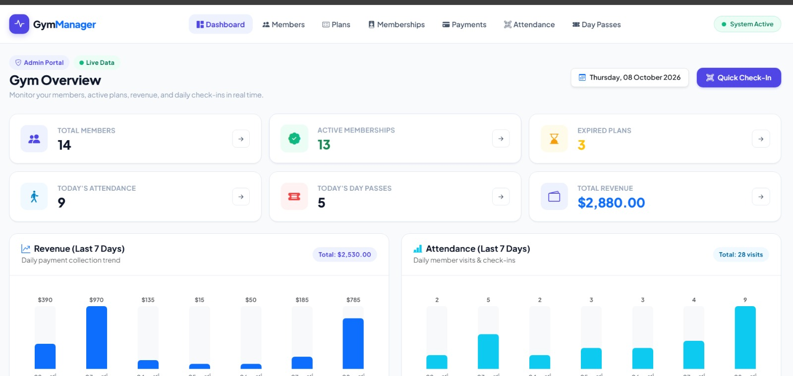
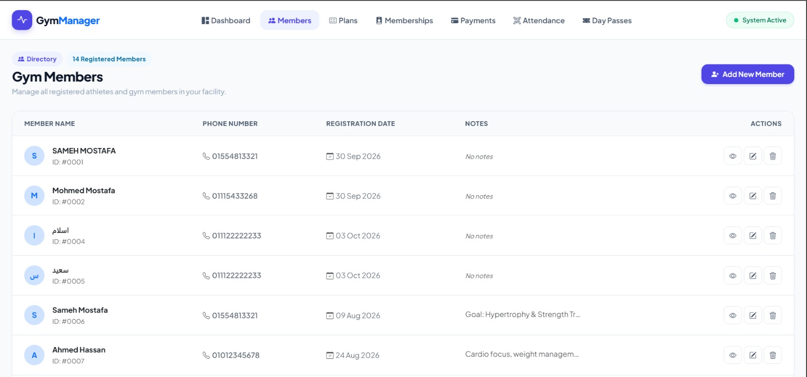
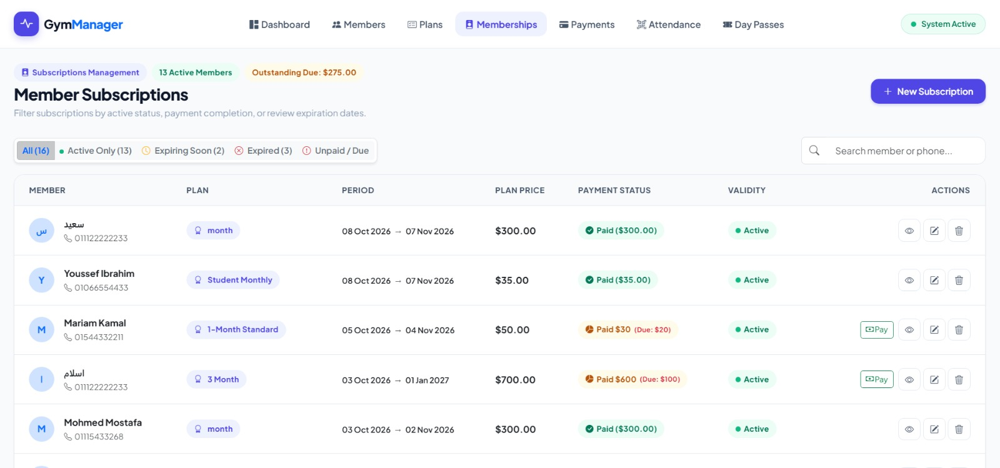
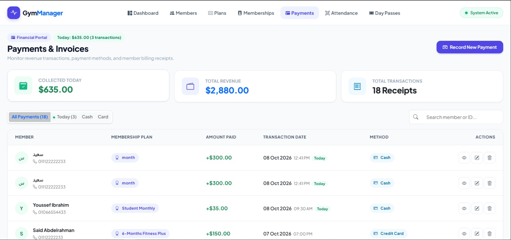
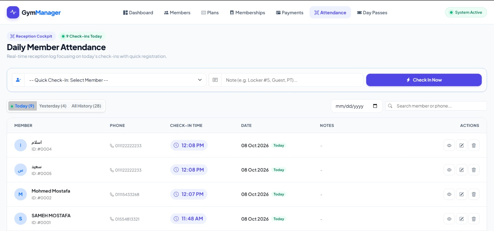
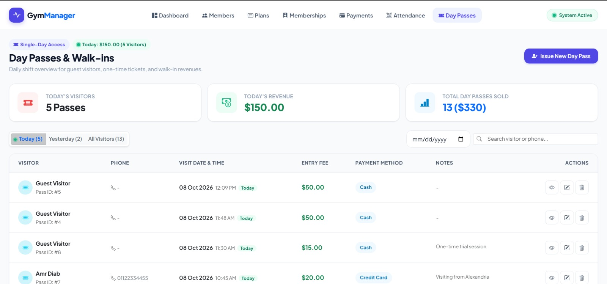

# GymManager

<p align="center">
  
  
  
  
</p>

> A full-featured gym management system built with ASP.NET Core MVC — designed for real daily use by gym owners and receptionists.

---

## ✨ Features

### 👥 Members
- Add, edit, and manage gym members
- Full member profile with notes and contact info

### 📋 Memberships
- Track active, expiring, and expired subscriptions
- **Payment status per membership** — Paid / Partial (shows remaining balance) / Unpaid
- Filter tabs: All · Active · Expiring Soon · Expired · Unpaid
- Quick Pay button for fast payment registration

### 💰 Payments
- Log payments by cash or card
- KPI cards: Today's revenue · Total revenue · Transaction count
- Filter by: Today · Cash · Card

### 📅 Attendance
- **Reception Cockpit** — Quick check-in without leaving the page
- Default view: Today's check-ins
- Navigate: Today · Yesterday · All History · Pick a date

### 🎟️ Day Passes
- Walk-in guest management (no membership required)
- Daily shift view with revenue tracking
- Filter: Today · Yesterday · All · Date picker

### 📊 Dashboard
- 6 KPI stat cards (members, active subscriptions, revenue, attendance...)
- 7-day bar charts: Revenue & Attendance trends
- Expiring memberships alert table
- Recent payments & attendance quick-view

---

## 🖼️ Screenshots

| Dashboard | Members | Memberships |
|-----------|---------|-------------|
|  |  |  |

| Payments | Attendance | Day Passes |
|----------|------------|------------|
|  |  |  |

---

## 🛠️ Tech Stack

| Layer | Technology |
|-------|-----------|
| Framework | ASP.NET Core MVC (.NET 10) |
| ORM | Entity Framework Core |
| Database | SQL Server |
| UI | Bootstrap 5 + Custom Indigo SaaS Design System |
| Icons | Bootstrap Icons |
| Font | Plus Jakarta Sans |

---

## 🚀 Getting Started

### Prerequisites
- [.NET 10 SDK](https://dotnet.microsoft.com/download)
- SQL Server (LocalDB works fine)
- Visual Studio 2022+ or VS Code

### Installation

```bash
# 1. Clone the repo
git clone https://github.com/YOUR_USERNAME/GymManager.git
cd GymManager

# 2. Set up your connection string in appsettings.json
# Update "DefaultConnection" to point to your SQL Server instance

# 3. Apply database migrations
dotnet ef database update

# 4. Run the app
dotnet run
```

Open your browser at `https://localhost:5001`

---

## 🌱 Seed Data

The app includes a full realistic seed dataset that loads automatically on first run:

- **6** membership plans (Monthly, Quarterly, Semi-annual, Annual VIP, Student, Weekend)
- **10** members with Arabic names
- **11** memberships (Active / Expiring Soon / Expired / Paid / Partial / Unpaid)
- **11** payment records (Cash & Card, recent + today)
- **20** attendance records (across 7 days, with today's check-ins)
- **8** day passes (today + historical)

> Seed runs only once — if the Members table already has data, it skips safely.

---

## 📁 Project Structure

```
GymManager/
├── Controllers/        # MVC Controllers
├── Models/             # Entity models
├── Views/              # Razor views (per controller)
│   ├── Shared/         # _Layout, Error
│   ├── Dashboard/
│   ├── Members/
│   ├── Memberships/
│   ├── Payments/
│   ├── Attendance/
│   └── DayPasse/
├── Data/
│   ├── GymDbContext.cs
│   └── GymDbSeeder.cs  # Seed data
└── wwwroot/
    └── css/site.css    # Full design system
```

---

## 📄 License

This project is open source and available under the [MIT License](LICENSE).

---

<p align="center">Built with ❤️ using ASP.NET Core MVC</p>
